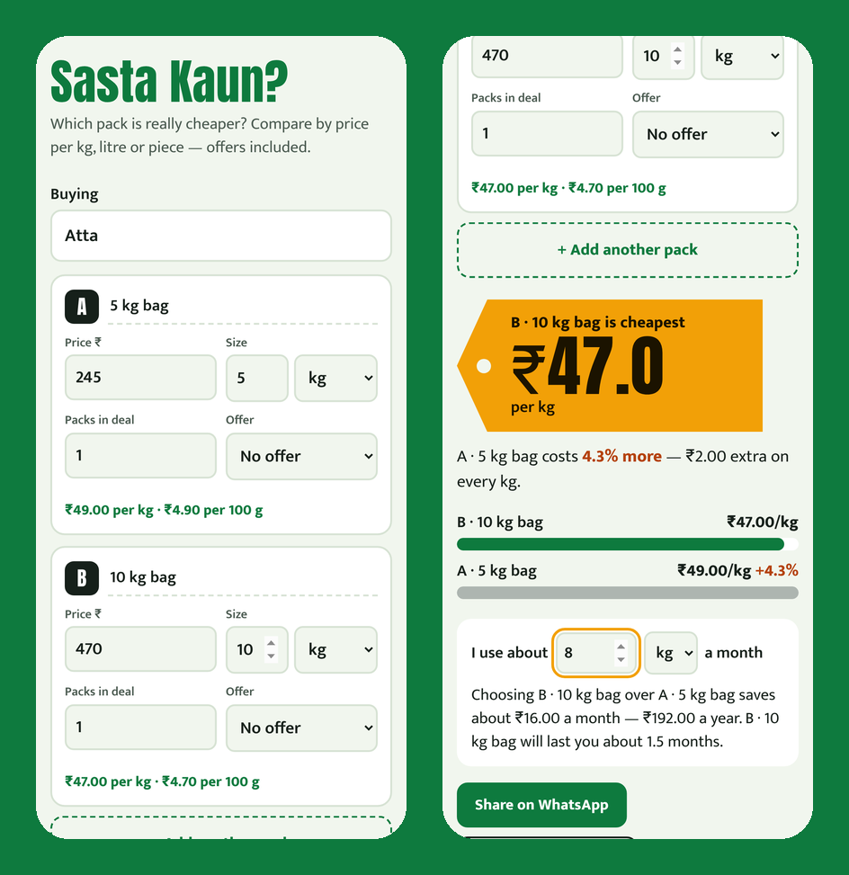

# Sasta Kaun?

**Which pack is really cheaper? Compare by price per kg, litre or piece — with buy-X-get-Y, % off and ₹ off offers — and see how much you save a month.**

### ▶ Use it now: https://jainronakwork-jr.github.io/sasta-kaun/

Is the 10 kg atta bag cheaper than two 5 kg bags? Is the "3+1 free" soap offer better than the big bar? Is the 650 ml shampoo with 10% off cheaper than sachets? Sasta Kaun answers in seconds while you are standing in the shop.



## What it does

- Compare 2–6 packs side by side; any mix of g/kg, ml/L, pieces/dozen, metres.
- Handles real Indian offers: **Buy X get Y free**, **% off**, **₹ off**, and multi-packs ("pack of 16 sachets").
- Shows price per kg/L/piece and per 100 g/100 ml for every pack, with the winner on a big price tag and "% more" for the others.
- Enter how much you use a month to see **savings per month and per year**, and how long the big pack will last (with a nudge to check the expiry date).
- Share the comparison on WhatsApp; save comparisons for next time.
- Works offline in the shop. No sign-up, no ads, no tracking.

## Install it like an app

Open the link on your phone, then:
- **Android (Chrome):** menu ⋮ → *Add to Home screen* / *Install app*.
- **iPhone (Safari):** Share → *Add to Home Screen*.

After the first visit it works with no internet.

## Privacy

There is no server, no account, no analytics. Everything you type is stored only in your own browser on your own device. Clearing your browser data deletes it — use the backup option where available.

## Run it yourself

It is a plain static website — no build step, no dependencies.

```bash
git clone https://github.com/jainronakwork-jr/sasta-kaun.git
cd sasta-kaun
python3 -m http.server 8000
# open http://localhost:8000
```

Or host the folder on any static host (GitHub Pages, Netlify, Cloudflare Pages).

## Project structure

```
index.html            page
style.css             design
app.js                
sw.js                 offline support (service worker)
manifest.webmanifest  install-as-app settings
fonts/                self-hosted fonts (SIL Open Font License)
icons/, icon.svg      app icons
```

## License

MIT — free to use, share and improve. Fonts are from [Fontsource](https://fontsource.org) under the SIL Open Font License.
